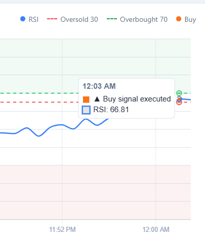

<div align="center">

# BinanceTradingBot

**A self-hosted spot trading bot for Binance, with a live dashboard, a simulator that runs the live code, and optional LLM agents.**

[](https://github.com/hammrouni/BinanceTradingBot/actions/workflows/ci.yml)
[](LICENSE)




</div>

> ⚠️ **Trading is risky and this is educational software, not financial advice.** Start on the Binance **testnet**, never enable withdrawals on your API keys, and only trade money you can afford to lose. See [Safety and limitations](docs/safety.md).

## Features

- **Three strategies** on 1-minute candles: `RSI`, `RSI Ultra` and `BC` (fixed buy/sell price targets), with optional trend and bounce filters.
- **Risk management**: stop-loss, trailing stop, take-profit and a support-level stop, checked on every price tick and restored after a restart.
- **Spot only**: no leverage, no margin, no withdrawals.
- **Real-time dashboard**: candlestick and RSI charts, open position, wallets, trade history with fees and net P&L, manual buy/sell, log viewer.
- **Simulator**: grid-search backtests and an **AI Optimizer**, replayed through the live strategy and risk code with fees, so results match what the bot would do.
- **AI assistants (optional)**: a chat with read-only tools, an MCP server, and six PHP micro-agents built on [NanoAgent](https://github.com/hammrouni/nanoagentphp). Works with any OpenAI-compatible LLM, including a local Ollama. The agents advise; they never trade.
- **Safe defaults**: testnet first, binds to `127.0.0.1`, optional dashboard token, secrets masked in logs, a restarted bot comes back paused.

## Quick start

You need Binance API keys: a production key for market data (read-only is enough) and a [testnet](https://testnet.binance.vision) key for trading.

### With Docker

```bash
git clone https://github.com/hammrouni/BinanceTradingBot.git
cd BinanceTradingBot
cp .env.example .env        # then put your keys in .env
docker compose up -d --build
```

### With Python

```bash
git clone https://github.com/hammrouni/BinanceTradingBot.git
cd BinanceTradingBot
python -m venv venv && source venv/bin/activate    # Windows: venv\Scripts\activate
pip install -r requirements.txt
cp .env.example .env        # then put your keys in .env
python -m uvicorn main:app --host 127.0.0.1 --port 8000
```

Open <http://localhost:8000>, choose a strategy and press **Start**. The bot trades on testnet until you set `TRADING_ENV=live`.

## Strategies at a glance

| Mode | Buys when | Sells when |
|---|---|---|
| `RSI` | RSI crosses below the oversold level | RSI crosses above the overbought level |
| `RSI_ULTRA` | RSI Ultra crosses above its signal line in the lower zone | RSI Ultra crosses below its signal line in the upper zone |
| `BC` | Price falls to your buy price | Price rises to your sell price |

Stop-loss, trailing stop and take-profit apply to all of them. Details: [strategies.md](docs/strategies.md).

## Documentation

| Topic | Page |
|---|---|
| Install, run, Docker, dashboard token | [Getting started](docs/getting-started.md) |
| Dashboard walkthrough for beginners | [User guide](docs/USER_GUIDE.md) · [العربية](docs/USER_GUIDE_AR.md) |
| Every `.env` variable and trading parameter | [Configuration](docs/configuration.md) |
| Strategies, filters, risk rules, bot states | [Strategies](docs/strategies.md) |
| Backtesting and the AI Optimizer | [Simulator](docs/simulator.md) |
| Chat, MCP server and agents | [AI features](docs/ai-features.md) · [Agent service](docs/agent-service.md) |
| REST, WebSocket and MCP endpoints | [API reference](docs/api.md) |
| Components and code layout | [Architecture](docs/architecture.md) |
| Tests, lint, CI | [Development](docs/development.md) |
| Risks and known gaps | [Safety and limitations](docs/safety.md) |
| What changed in each release | [Changelog](CHANGELOG.md) |

## Contributing

Issues and pull requests are welcome. Read [CONTRIBUTING.md](CONTRIBUTING.md) first; the short version: never commit keys, keep changes small, add tests.

## License

[MIT](LICENSE). The software is provided as is, with no warranty. You are responsible for your own trades.
