# BinanceTradingBot — Comprehensive User Guide

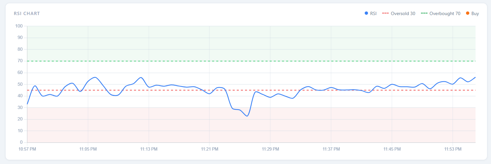

Welcome to the **BinanceTradingBot** user guide. This document explains how the bot works, the trading terms used, and a complete walkthrough of every feature — so you can trade cryptocurrency safely and effectively, whether you are a beginner or an experienced trader.

---

## Table of Contents

1. [What Is This Bot?](#1-what-is-this-bot)
2. [Technical Trading Terms — Deep Explanations](#2-technical-trading-terms--deep-explanations)
   - 2.1 RSI — Relative Strength Index
   - 2.2 Notional Value
   - 2.3 Lot Size & Precision
   - 2.4 Stop-Loss
   - 2.5 Unrealized P&L
   - 2.6 Market Momentum Zones
3. [How the Bot Makes Decisions](#3-how-the-bot-makes-decisions)
4. [Interface Walkthrough](#4-interface-walkthrough)
   - 4.1 Header / Status Bar
   - 4.2 Live Price & RSI Ticker
   - 4.3 Bot Status & Controls
   - 4.4 Configuration Panel
   - 4.5 RSI Chart
   - 4.6 Open Position Panel
   - 4.7 Trade History
5. [Configuration Guide](#5-configuration-guide)
6. [Troubleshooting Common Errors](#6-troubleshooting-common-errors)

---

## 1. What Is This Bot?

BinanceTradingBot is an **automated spot trading system** for the Binance exchange. It continuously monitors market momentum using the RSI indicator, then buys and sells a chosen cryptocurrency on your behalf — without requiring you to watch the market around the clock.

### Key Features

| Feature | Description |
|---|---|
| **Dual-Client Architecture** | Uses real Binance production market data for the highest accuracy, even when trading on the Testnet |
| **RSI Strategy** | Automatically buys when momentum is low (oversold) and sells when high (overbought) |
| **Stop-Loss Protection** | Automatically exits a losing trade before your losses become too large |
| **Notional Value Enforcement** | Every order is validated against Binance's minimum order rules before being placed |
| **Real-Time Dashboard** | Live RSI chart, live price, position details, and trade history — all in one view |

---

## 2. Technical Trading Terms — Deep Explanations

### 2.1 RSI — Relative Strength Index

**RSI** stands for *Relative Strength Index*. It is the core indicator the bot uses to decide when to buy and when to sell.

#### What does RSI actually measure?

RSI measures **how fast and how much the price has been rising versus falling** over a fixed period (this bot uses the standard 14-candle period, written as RSI(14)).

The formula compares the average gains to the average losses over those 14 candles and outputs a single number between **0 and 100**.

#### Interpreting RSI values

| RSI Range | Market Condition | Meaning | Bot Action |
|---|---|---|---|
| **0 – 30** | Oversold | The price has been falling too fast; it may be undervalued and due for a bounce | **Consider BUY** |
| **30 – 45** | Weak / Bearish | Price has some downward pressure | No action |
| **45 – 55** | Neutral | No clear momentum in either direction | No action |
| **55 – 70** | Strong / Bullish | Price has upward momentum | No action |
| **70 – 100** | Overbought | The price has risen too fast; it may be overvalued and due for a pullback | **Consider SELL** |

> **Important:** RSI does not predict the future. It is a probabilistic signal. The bot acts on these signals repeatedly, which means it generates profits over many trades on average — not necessarily on every single trade.

#### Reading the RSI Chart Zones

When the bot first starts and no price data has streamed in yet, the chart shows the coloured zones that define the strategy:

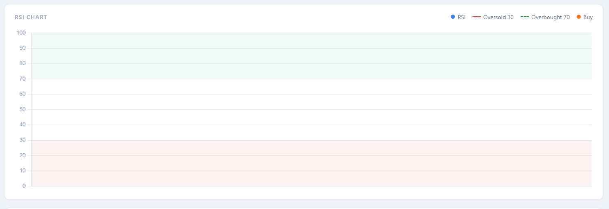

- **Green shaded area (above 70)**: The overbought zone. If the RSI line enters this area, a SELL signal may be triggered.
- **Red shaded area (below 30)**: The oversold zone. If the RSI line enters this area, a BUY signal may be triggered.
- **White/neutral area (30–70)**: No signal. The bot holds its current position.

#### RSI in action — live chart with a Buy signal

Once the bot is running and data starts flowing in, the RSI line appears and moves in real time:

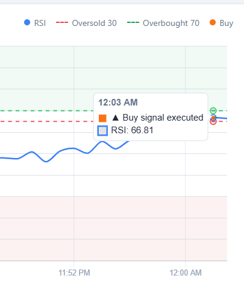

Notice the **orange triangle marker** on the chart — this is stamped exactly at the moment the bot detected an RSI crossover and executed a Buy order (RSI was 66.81 at 12:03 AM in this example). Every buy and sell execution is marked directly on the chart so you can review the bot's decisions visually.

#### Hovering over the chart

You can hover your mouse anywhere on the RSI chart to see the exact RSI value at that point in time:

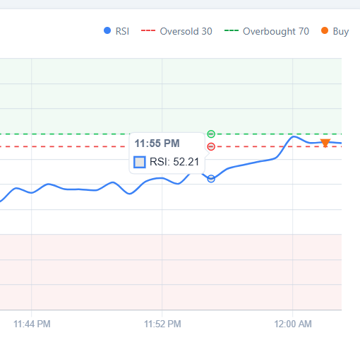

The tooltip shows the **timestamp** and **RSI value** at that moment. This is useful for reviewing whether a signal was correctly triggered.

---

### 2.2 Notional Value

**Notional Value** is the total dollar value of an order, calculated as:

```
Notional Value = Price × Quantity
```

**Example:**
- BTC price = $68,000
- You want to buy 0.000073 BTC
- Notional Value = $68,000 × 0.000073 = **$4.96**

Binance enforces a **Minimum Notional Value** per trading pair (typically between $5 and $10 USD). If the calculated notional value of your order falls below this minimum, Binance will **reject the order entirely** with a `MIN_NOTIONAL` error.

#### Why does this happen?

When the bot calculates how much cryptocurrency to buy, it divides your configured USD amount by the current price, then rounds the quantity down to comply with Lot Size rules (see 2.3). This rounding can sometimes reduce the notional value below the minimum threshold.

> [!TIP]
> Always set your **Trade Amount** to at least **$15.00 USD** to give a comfortable buffer above Binance's minimum after rounding is applied. Settings below $12 are very likely to result in rejected orders.

---

### 2.3 Lot Size & Precision

Every trading pair on Binance has strict formatting rules. There are two types of precision you need to understand:

#### Price Precision
The number of decimal places allowed in the **price** of an order. For example, if price precision is 2, you can place an order at $68,954.15 but not at $68,954.153.

#### Quantity Precision (Lot Size)
The minimum increment allowed for the **quantity** of cryptocurrency. For example:
- Lot size step = 0.00001 BTC
- You can buy 0.00007 BTC ✓
- You cannot buy 0.000073 BTC ✗ — it must be rounded down to 0.00007

The bot automatically handles both of these rules by **flooring** (rounding down) the calculated quantity and price to the correct number of decimal places before submitting any order. You never need to worry about this manually.

---

### 2.4 Stop-Loss

A **Stop-Loss** is a safety rule that automatically **exits your trade** if the price falls too far below your entry price. It is your primary protection against large losses.

#### How it is calculated

```
Stop-Loss Price = Entry Price × (1 − Stop-Loss %)
```

**Example with a 5% Stop-Loss:**
- Entry Price = $68,954.15
- Stop-Loss Price = $68,954.15 × (1 − 0.05) = **$65,506.44**

If the price drops to or below $65,506.44, the bot immediately sells your entire position, locking in a 5% loss rather than allowing the loss to grow further.

You can see the Stop-Loss price displayed in red in the Open Position panel:

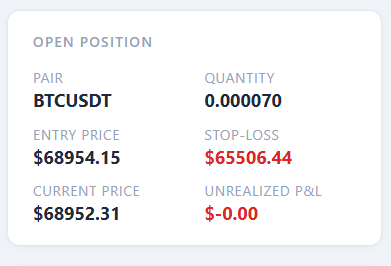

> [!WARNING]
> A lower Stop-Loss % means tighter protection but also more risk of being triggered by normal market fluctuations (noise). A higher Stop-Loss % gives the trade more room to breathe but exposes you to larger potential losses. A value of **3–7%** is typical for volatile crypto assets.

---

### 2.5 Unrealized P&L

**P&L** stands for *Profit and Loss*. "Unrealized" means the trade is still open — the profit or loss exists on paper but has not been locked in yet.

```
Unrealized P&L = (Current Price − Entry Price) × Quantity
```

**Example:**
- Entry Price = $68,954.15
- Current Price = $68,958.18
- Quantity = 0.000070 BTC
- Unrealized P&L = ($68,958.18 − $68,954.15) × 0.000070 = **+$0.00** (rounded to cents)

When the P&L is **green**, the position is currently profitable. When it is **red**, the position is currently at a loss. The P&L only becomes "realized" (permanent) when the bot closes the trade with a Sell order.

---

### 2.6 Market Momentum Zones

The live ticker shows an RSI label that classifies the current momentum into a human-readable zone:

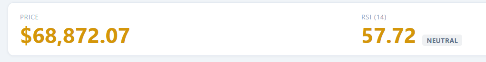

| Label | RSI Range | Meaning |
|---|---|---|
| **OVERSOLD** | < 30 | Buy signal zone — bot may enter a trade |
| **WEAK** | 30–45 | Mild bearish momentum |
| **NEUTRAL** | 45–55 | No clear direction |
| **STRONG** | 55–70 | Mild bullish momentum |
| **OVERBOUGHT** | > 70 | Sell signal zone — bot may exit a trade |

---

## 3. How the Bot Makes Decisions

Understanding the full decision cycle helps you configure the bot effectively:

```
Every ~3 seconds:
  1. Fetch the latest price candle from Binance
  2. Recalculate RSI(14) from the last 14 candles
  3. Update the live chart and ticker

  IF no open position:
    IF RSI < BUY_THRESHOLD → Place a BUY market order
    ELSE → Wait

  IF open position exists:
    IF current price ≤ stop-loss price → Place a SELL (stop-loss triggered)
    ELSE IF RSI > SELL_THRESHOLD (70) → Place a SELL (take profit)
    ELSE → Hold and monitor
```

> The bot trades **one position at a time**. It will not open a new trade while one is already open.

---

## 4. Interface Walkthrough

### 4.1 Header / Status Bar

The header bar is always visible at the top of the page and gives you an at-a-glance summary of the bot's state.

**When the bot is stopped:**

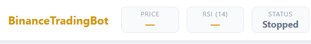

**When the bot is running with live data:**

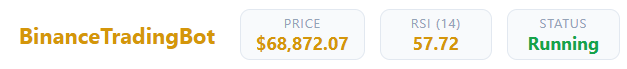

| Element | Description |
|---|---|
| **BinanceTradingBot** (gold) | Application name / home link |
| **PRICE** | Current live market price of the trading pair |
| **RSI (14)** | Current RSI value calculated from real-time data |
| **STATUS** | `Running` (green) · `Stopped` (grey) · `Paused` (yellow) |

---

### 4.2 Live Price & RSI Ticker

Below the header, a dedicated ticker card shows the current price and RSI with their momentum label. This updates every few seconds:

**Loading state** (bot just started, waiting for first data):

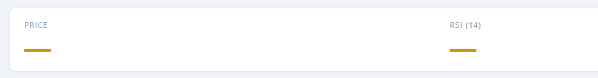

**Active state** (data received):


The gold colour of the numbers indicates that these values are coming from the **production Binance API**, ensuring the highest accuracy regardless of whether you are trading on Testnet or Live.

Also note the **environment badge** in the corner:

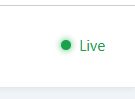

This badge shows `Live` (green) or `Testnet` to make it immediately clear which environment your trades are being executed in.

---

### 4.3 Bot Status & Controls

The controls panel shows the current bot status and gives you a single button to start, pause, or stop the bot.

**When stopped** — the bot is not running and not watching the market:

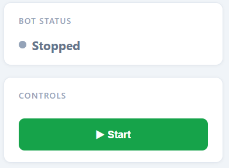

Press **Start** to begin live monitoring and trading.

**When running** — the bot is actively monitoring and trading:

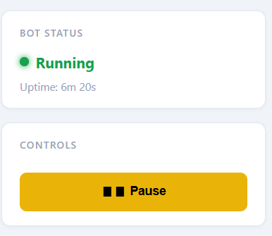

- The **green dot** confirms the bot is live.
- **Uptime** shows how long the bot has been running in this session.
- Press **Pause** to temporarily halt trading without losing state (the current position is held).

---

### 4.4 Configuration Panel

All trading parameters are set here. Changes take effect the next time you press **Save Configuration**.

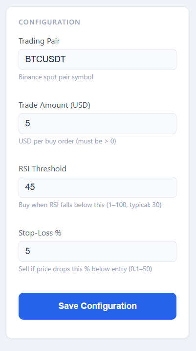

| Field | What It Controls | Recommended Value |
|---|---|---|
| **Trading Pair** | The market to trade (e.g., `BTCUSDT`, `ETHUSDT`) | Any Binance spot pair |
| **Trade Amount (USD)** | How many USD worth of crypto to buy per signal | $15 minimum |
| **RSI Threshold** | RSI value below which the bot triggers a BUY | 30 (default); 45 for more frequent trades |
| **Stop-Loss %** | How far price can fall before force-selling | 3–7% recommended |

> [!TIP]
> A lower **RSI Threshold** (e.g., 25) means the bot waits for stronger oversold conditions before buying — fewer trades, but higher-quality signals. A higher threshold (e.g., 45) generates more trades but with lower confidence per signal.

---

### 4.5 RSI Chart

The RSI chart is the main analysis view. It plots the RSI(14) value over time and marks every trade execution.


#### Chart Legend

| Visual Element | Meaning |
|---|---|
| **Blue solid line** | RSI(14) value over time — this is what the bot watches |
| **Red dashed line** | Your configured Buy threshold (e.g., 30 or 45) |
| **Green dashed line** | Overbought level (70) — where the bot sells |
| **Orange triangle marker** | A BUY order was executed at this point |
| **Green shaded zone** | Overbought region (RSI > 70) |
| **Red shaded zone** | Oversold region (RSI < configured threshold) |

#### What to look for

- When the **blue line dips below the red dashed line** and then **crosses back up**, that is the buy signal.
- When the **blue line rises above 70** and is already in a position, that is the sell signal.
- A very flat RSI hovering in the 40–60 range means the market is ranging with no clear momentum — the bot will simply wait.

---

### 4.6 Open Position Panel

When the bot has an active trade open, this panel shows all the details needed to monitor it in real time.

**Profitable position** (current price above entry):

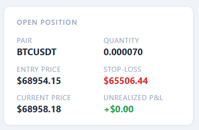

**Position at risk** (current price approaching stop-loss, P&L shown in red):


| Field | Description |
|---|---|
| **PAIR** | The trading pair currently held (e.g., `BTCUSDT`) |
| **QUANTITY** | How many units of the base asset you hold |
| **ENTRY PRICE** | The price at which the BUY order was filled |
| **STOP-LOSS** | The price level that will trigger an automatic sell (shown in red) |
| **CURRENT PRICE** | The latest real-time market price |
| **UNREALIZED P&L** | Your current paper profit or loss in USD |

> If no trade is open, this panel is hidden. It only appears when the bot holds an active position.

---

### 4.7 Trade History

The trade history table provides a permanent log of every order executed in the current session, including the final profit or loss of each completed trade cycle.

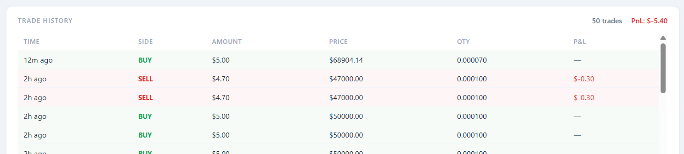

| Column | Description |
|---|---|
| **TIME** | How long ago the order was filled |
| **SIDE** | `BUY` (green) or `SELL` (red) |
| **AMOUNT** | The USD value of the order |
| **PRICE** | The fill price |
| **QTY** | The quantity of cryptocurrency traded |
| **P&L** | The profit or loss for the completed buy→sell cycle (shown only on SELL rows) |

The total **PnL** for the session is displayed in the top-right of the table (e.g., `PnL: $-5.40`). This is the sum of all completed trade cycles — not including any currently open unrealized position.

---

## 5. Configuration Guide

### Step 1 — API Keys

Edit your `.env` file in the project root with your Binance API credentials:

```env
# Production Keys — used ONLY for reading market data (price, RSI)
PROD_BINANCE_API_KEY=your_production_api_key
PROD_BINANCE_API_SECRET=your_production_api_secret

# Trading Keys — used for placing actual orders
# Set TRADING_ENV to "testnet" for safe practice or "live" for real money
TRADING_BINANCE_API_KEY=your_trading_api_key
TRADING_BINANCE_API_SECRET=your_trading_api_secret
TRADING_ENV=testnet
```

> [!IMPORTANT]
> Your **Production keys** only need **Read** permission — they are never used to place orders. Your **Trading keys** need **Spot Trading** permission. Never give either set of keys **Withdrawal** permission.

### Step 2 — Dashboard Configuration

Once the server is running, open the dashboard and fill in the **Configuration** panel:

1. **Trading Pair** — Enter a valid Binance spot symbol (e.g., `BTCUSDT`, `ETHUSDT`, `SOLUSDT`).
2. **Trade Amount** — Enter the USD amount per trade. Start with **$15–$20** while testing.
3. **RSI Threshold** — Start with the default of **30**. Increase to 45 if you want more frequent trades.
4. **Stop-Loss %** — Start with **5%**. Tighten to 3% if you are more risk-averse.
5. Press **Save Configuration**.

### Step 3 — Start the Bot

Press the green **Start** button. The bot will:
1. Load the last 14 price candles to pre-calculate an initial RSI value.
2. Begin streaming live price data.
3. Start displaying RSI on the chart.
4. Begin checking buy/sell conditions every ~3 seconds.

---

## 6. Troubleshooting Common Errors

### `Order rejected: MIN_NOTIONAL`
- **Cause**: The calculated order quantity × price is below Binance's minimum notional value for this pair.
- **Fix**: Increase `Trade Amount (USD)` to at least **$15.00** in the Configuration panel.

### `Account has insufficient balance`
- **Cause**: Your trading account does not have enough USDT to place a buy order, or not enough of the base coin to place a sell order.
- **Fix**: Deposit more funds into your Binance trading account. If using Testnet, reset your Testnet balance from the Binance Testnet dashboard.

### `Signature is invalid`
- **Cause**: The API key or secret in your `.env` file is incorrect, contains extra spaces, or the key has been revoked.
- **Fix**: Copy the keys again directly from the Binance API Management page and paste them into `.env`. Make sure there are no leading/trailing spaces.

### `RSI chart is empty / no data appears`
- **Cause**: The bot has just started and is waiting for the first batch of candle data to arrive from Binance.
- **Fix**: Wait 10–20 seconds. Data will appear automatically once the first candles are received.

### Bot keeps buying and immediately hitting stop-loss
- **Cause**: Your Stop-Loss % is too tight relative to the pair's normal volatility.
- **Fix**: Increase Stop-Loss % to 5–7%, or lower the RSI Threshold to only buy during stronger oversold conditions.

---

*BinanceTradingBot — Automated Precision for Crypto Traders*
