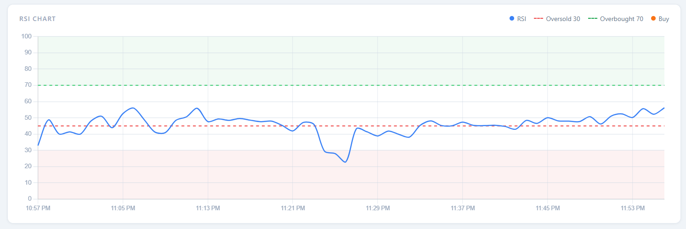
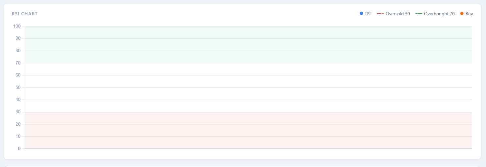
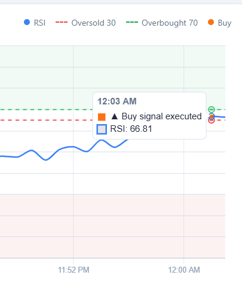
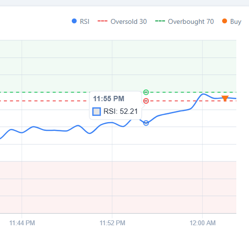
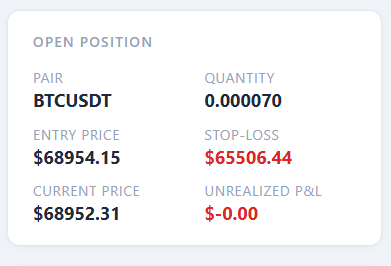
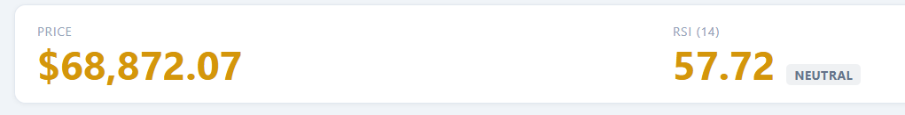
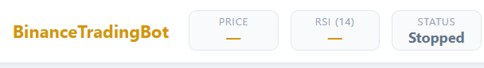
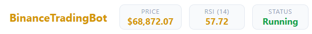

# BinanceTradingBot — دليل المستخدم الشامل



مرحبًا بك في دليل مستخدم **BinanceTradingBot**. يوضح هذا المستند كيفية عمل البوت، ومصطلحات التداول المستخدمة، وجولة في جميع الميزات لمساعدتك في تداول العملات الرقمية بأمان وفعالية، سواء كنت مبتدئًا أو متداولًا متمرسًا.

---

## جدول المحتويات

1. [ما هو هذا البوت؟](#1-ما-is-this-bot)
2. [مصطلحات التداول التقنية — شرح تفصيلي](#2-mصطلحات-التداول-технические--شرح-تفصيلي)
    - 2.1 RSI — مؤشر القوة النسبية
    - 2.2 القيمة الاسمية
    - 2.3 حجم الحصة والدقة
    - 2.4 وقف الخسارة
    - 2.5 الربح والخسارة غير المحققين
    - 2.6 مناطق زخم السوق
3. [كيف يتخذ البوت القرارات](#3-how-the-bot-makes-decisions)
4. [جولة في الواجهة](#4-interface-walkthrough)
    - 4.1 شريط العناوين / حالة التشغيل
    - 4.2 شريط السعر الحي ومؤشر RSI
    - 4.3 حالة البوت وعناصر التحكم
    - 4.4 لوحة الإعدادات
    - 4.5 مخطط RSI
    - 4.6 لوحة المركز المفتوح
    - 4.7 سجل التداول
5. [دليل الإعداد](#5-configuration-guide)
6. [استكشاف الأخطاء وإصلاحها الشائعة](#6-troubleshooting-common-errors)

---

## 1. ما هو هذا البوت؟

BinanceTradingBot هو نظام تداول فوري آلي لمنصة Binance. يراقب باستمرار زخم السوق باستخدام مؤشر RSI، ثم يشتري ويبيع عملة رقمية נבחرة نيابة عنك — دون الحاجة إلى مراقبة السوق على مدار الساعة.

### الميزات الرئيسية

| الميزة | الوصف |
|---|---|
| **هندسة العميل المزدوج** | يستخدم بيانات سوق الإنتاج من Binance لأعلى دقة، حتى عند التداول على الشبكة التجريبية (Testnet) |
| **استراتيجية RSI** | يشتري تلقائيًا عندما يكون الزخم منخفضًا (ذروة البيع) ويبيع عندما يكون عاليًا (ذروة الشراء) |
| **حماية وقف الخسارة** | يخرج تلقائيًا من صفقة خاسرة قبل أن تصبح الخسائر كبيرة جدًا |
| **فرض قيمة اسمية** | يتحقق من كل أمر مقابل الحد الأدنى لقواعد Binance قبل وضعه |
| **لوحة تحكم في الوقت الفعلي** | مخطط RSI حي، سعر حي، تفاصيل المركز، وسجل تداول — كل ذلك في عرض واحد |

---

## 2. مصطلحات التداول التقنية — شرح تفصيلي

### 2.1 RSI — مؤشر القوة النسبية

**RSI** يرمز إلى *مؤشر القوة النسبية*. إنه المؤشر الأساسي الذي يستخدمه البوت لتحديد متى يشتري ومتى يبيع.

#### ما الذي يقيسه RSI في الواقع؟

يقيس RSI **سرعة وكمية ارتفاع السعر مقابل انخفاضه** خلال فترة ثابتة (يستخدم هذا البوت الفترة القياسية 14 شمعة، مكتوبة كـ RSI(14)).

تقارن الصيغة المتوسطات للمكاسب والمتوسطات للخسائر خلال تلك 14 شمعة وتنتج رقمًا واحدًا بين **0 و 100**.

#### تفسير قيم RSI

| نطاق RSI | حالة السوق | المعنى | إجراء البوت |
|---|---|---|---|
| **0 – 30** | ذروة البيع | انخفض السعر بسرعة كبيرة؛ قد يكون underestimated ومستعد للارتداد | **افكر في الشراء** |
| **30 – 45** | ضعيف / هابط | السعر يعاني بعض الضغط الهبوطي | لا إجراء |
| **45 – 55** | محايد | لا يوجد زخم واضح في أي اتجاه | لا إجراء |
| **55 – 70** | قوي / صاعد | السعر لديه زخم صعودي | لا إجراء |
| **70 – 100** | ذروة الشراء | ارتفع السعر بسرعة كبيرة؛ قد يكون مكلفًا ومستعد للانخفاض | **افكر في البيع** |

> **ملحوظة مهمة:** RSI لا يتنبأ بالمستقبل. إنه إشارة احتمالية. يتصرف البوت بناءً على هذه الإشارات بشكل متكرر، مما يعني أنه يحقق أرباحًا في المتوسط عبر العديد من الصفقات — وليس بالضرورة في كل صفقة منفردة.

#### قراءة مناطق مخطط RSI

عندما يبدأ البوت لأول مرة ولا توجد بيانات سعرية قد تدفقت بعد، يعرض المخطط المناطق الملونة التي تحدد الاستراتيجية:



- **المنطقة المظللة الخضراء (فوق 70)**: منطقة ذروة الشراء. إذا دخل خط RSI هذه المنطقة، قد يتم تفعيل إشارة بيع.
- **المنطقة المظللة الحمراء (تحت 30)**: منطقة ذروة البيع. إذا دخل خط RSI هذه المنطقة، قد يتم تفعيل إشارة شراء.
- **المنطقة البيضاء/المحايدة (30–70)**: لا إشارة. يحتفظ البوت بمركزه الحالي.

#### RSI في العمل — مخطط حي مع إشارة شراء

بمجرد أن يبدأ البوت بالتشغيل وتبدأ البيانات في التدفق، يظهر خط RSI ويتحرك في الوقت الفعلي:



لاحظ **العلامة المثلثة البرتقالية** على المخطط — هذه مُسجّلة بالضبط في اللحظة التي اكتشف فيها البوت تقاطع RSI ونفّذ أمرًا للشراء (كان RSI عند 66.81 عند الساعة 12:03 صباحًا في هذا المثال). كل تنفيذ للشراء والبيع يتم تمييزه مباشرة على المخطط zodat يمكنك مراجعة قرارات البوت بصريًا.

#### التمرير فوق المخطط

يمكنك تمرير الماوس في أي مكان على مخطط RSI لرؤية القيمة الدقيقة لـ RSI في تلك النقطة الزمنية:



يُظهر التلميح **الطابع الزمني** و**قيمة RSI** في تلك اللحظة. هذا مفيد لمراجعة ما إذا كانت الإشارة قد تم تفعيلها بشكل صحيح.

---

### 2.2 القيمة الاسمية

**القيمة الاسمية** هي القيمة الإجمالية بالدولار لأمر، وتحسب كالتالي:

```
القيمة الاسمية = السعر × الكمية
```

**مثال:**
- سعر BTC = 68,000 دولار
- تريد شراء 0.000073 BTC
- القيمة الاسمية = 68,000 × 0.000073 = **4.96 دولار**

تفرض Binance **حدًا أدنى للقيمة الاسمية** لكل زوج تداول (عادة ما يكون بين 5 و 10 دولارات أمريكية). إذا انخفض القيمة الاسمية المحسوبة لأمرك عن هذا الحد الأدنى، ستقوم Binance **برفض الأمر بالكامل** بخطأ `MIN_NOTIONAL`.

#### لماذا يحدث هذا؟

عندما يحسب البوت كمية العملة الرقمية التي يجب شراؤها، فإنه يقسم مبلغ الدولار المُكوّن على السعر الحالي، ثم يقرب الكمية لأسفل للامتثال لقواعد حجم الحصة (انظر 2.3). يمكن لهذا التقريب أن يقلل أحيانًا القيمة الاسمية إلى أقل من الحد الأدنى.

> [!TIP]
> احرص دائمًا على ضبط **مبلغ التداول** إلى **15.00 دولار أمريكي على الأقل** لتوفير مساحة مريحة فوق الحد الأدنى لـ Binance بعد التقريب. الإعدادات أقل من 12 دولارًا من المرجح للغاية أن تؤدي إلى رفض الأوامر.

---

### 2.3 حجم الحصة والدقة

لكل زوج تداول على Binance قواعد تنسيق صارمة. هناك نوعان من الدقة تحتاج إلى فهمها:

#### دقة السعر
عدد الخانات العشرية المسموح بها في **سعر** الأمر. على سبيل المثال، إذا كانت دقة السعر هي 2، يمكنك وضع أمر بسعر 68,954.15 لكن ليس بـ 68,954.153.

#### دقة الكمية (حجم الحصة)
أقل زيادة مسموح بها لـ **كمية** العملة الرقمية. على سبيل المثال:
- خطوة حجم الحصة = 0.00001 BTC
- يمكنك شراء 0.00007 BTC ✓
- لا يمكنك شراء 0.000073 BTC ✗ — يجب تقريبها لأسفل إلى 0.00007

يقوم البوت تلقائيًا بمعالجة كلا هذين القاعدين عن طريق **التقريب لأسفل** (تقريب Down) للكمية والسعر المحسوبين إلى عدد الخانات العشرية الصحيح قبل إرسال أي أمر. لا تحتاج أبدًا إلى القلق بشأن هذا يدويًا.

---

### 2.4 وقف الخسارة

**وقف الخسارة** هو قاعدة أمان تُخرج تلقائيًا تجارتك إذا انخفض السعر بعيدًا جدًا تحت سعر الدخول. إنه حميتك الأساسية ضد الخسائر الكبيرة.

#### كيف يتم حسابه

```
سعر وقف الخسارة = سعر الدخول × (1 − نسبة وقف الخسارة)
```

**مثال مع وقف خسارة 5%:**
- سعر الدخول = 68,954.15 دولار
- سعر وقف الخسارة = 68,954.15 × (1 − 0.05) = **65,506.44 دولار**

إذا انخفض السعر إلى ما دون أو يساوي 65,506.44 دولار، يبيع البوت فورًا مركزك بأكمله، مؤمنًا خسارة 5% بدلًا من السماح للخسارة بالنموurther.

يمكنك رؤية سعر وقف الخسارة المعروض باللون الأحمر في لوحة المركز المفتوح:



> [!WARNING]
> نسبة وقف الخسارة الأقل تعني حماية أشد但 أيضًا خطر أكبر من التفعيل بسبب التقلبات العادية للسوق (الضوضاء). نسبة وقف الخسارة الأعلى تمنح الصفقة مساحة أكبر للتأرجح لكنها تعرضك لخسائر محتملة أكبر. قيمة **3–7%** هي نموذجية للأصول الرقمية المتقلبة.

---

### 2.5 الربح والخسارة غير المحققين

**P&L** يرمز إلى *الربح والخسارة*. "غير محقق" يعني أن التجارة لا تزال مفتوحة — الربح أو الخسارة موجود على الورق لكن لم يُثبت بعد.

```
الربح والخسارة غير المحقق = (السعر الحالي − سعر الدخول) × الكمية
```

**مثال:**
- سعر الدخول = 68,954.15 دولار
- السعر الحالي = 68,958.18 دولار
- الكمية = 0.000070 BTC
- الربح والخسارة غير المحقق = (68,958.18 − 68,954.15) × 0.000070 = **+0.00 دولار** (مُقرب إلى السنتات)

عندما يكون P&L **أخضر**، يكون المركز حاليًا مربحًا. عندما يكون P&L **أحمر**، يكون المركز حاليًا بخسارة. يصبح P&L "محقيقًا" (ثابتًا) فقط عندما يغلق البوت التجارة بأمر بيع.

---

### 2.6 مناطق زخم السوق

يعرض التicker الحي علامة RSI التي تصنف الزخم الحالي إلى منطقة يمكن قراءتها من قبل الإنسان:



| العلامة | نطاق RSI | المعنى |
|---|---|---|
| **ذروة البيع** | < 30 | منطقة إشارة شراء — قد يدخل البوت في صفقة |
| **ضعيف** | 30–45 | زخم هبوطي خفيف |
| **محايد** | 45–55 | لا اتجاه واضح |
| **قوي** | 55–70 | زخم صعودي خفيف |
| **ذروة الشراء** | > 70 | منطقة إشارة بيع — قد يخرج البوت من الصفقة |

---

## 3. كيف يتخذ البوت القرارات

فهم دورة القرار الكاملة يساعدك على تكوين البوت بفعالية:

```
كل ~3 ثوانٍ:
  1. أحضر أحدث شمعة سعر من Binance
  2. أعد حساب RSI(14) من آخر 14 شمعة
  3.حدّث المخطط الحي والشارة

  IF لا يوجد مركز مفتوح:
    IF RSI < عتبة الشراء → ضع أمرًا سوقيًا للشراء
    ELSE → انتظر

  IF يوجد مركز مفتوح:
    IF السعر الحالي ≤ سعر وقف الخسارة → ضع أمرًا بيعًا (تم تفعيل وقف الخسارة)
    ELSE IF RSI > عتبة البيع (70) → ضع أمرًا بيعًا (جني الربح)
    ELSE → احتفظ وراقب
```

> يتداول البوت **مركزًا واحدًا في المرة الواحدة**. لن يفتح صفقة جديدة بينما توجد صفقة مفتوحة بالفعل.

---

## 4. جولة في الواجهة

### 4.1 شريط العناوين / حالة التشغيل

شريط العناوين مرئي دائمًا في أعلى الصفحة ويعطيك لمحة سريعة عن حالة البوت.

**عندما يكون البوت متوقفًا:**



**عندما يكون البوت يعمل مع بيانات حية:**



| العنصر | الوصف |
|---|---|
| **BinanceTradingBot** (ذهبي) | اسم التطبيق / رابط للصفحة الرئيسية |
| **PRICE** | السعر الحي الحالي لزوج التداول |
| **RSI (14)** | قيمة RSI الحالية المحسوبة من البيانات الحقيقية |
| **STATUS** | `Running` (أخضر) · `Stopped` (رمادي) · `Paused` (أصفر) |

---

### 4.2 شريط السعر الحي ومؤشر RSI

تحت الشريط العلوي، بطاقة مخصصة تُظهر السعر الحالي وRSI مع علامة الزخم. يحدث هذا التحديث كل بضع ثوانٍ:

**حالة التحميل** (البوت بدأ للتو ويانتظر أول بيانات):

![شريط في حالة التحميل مع خطوط](